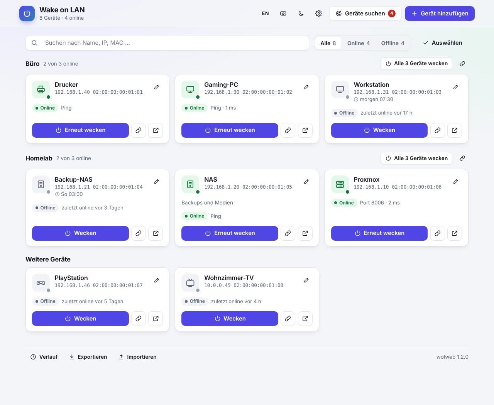
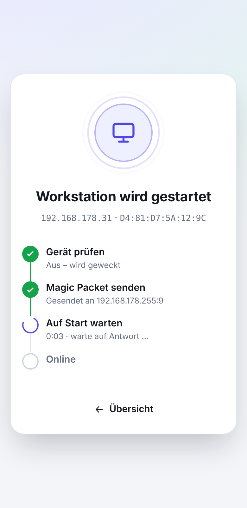
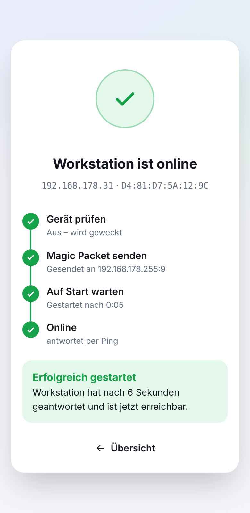
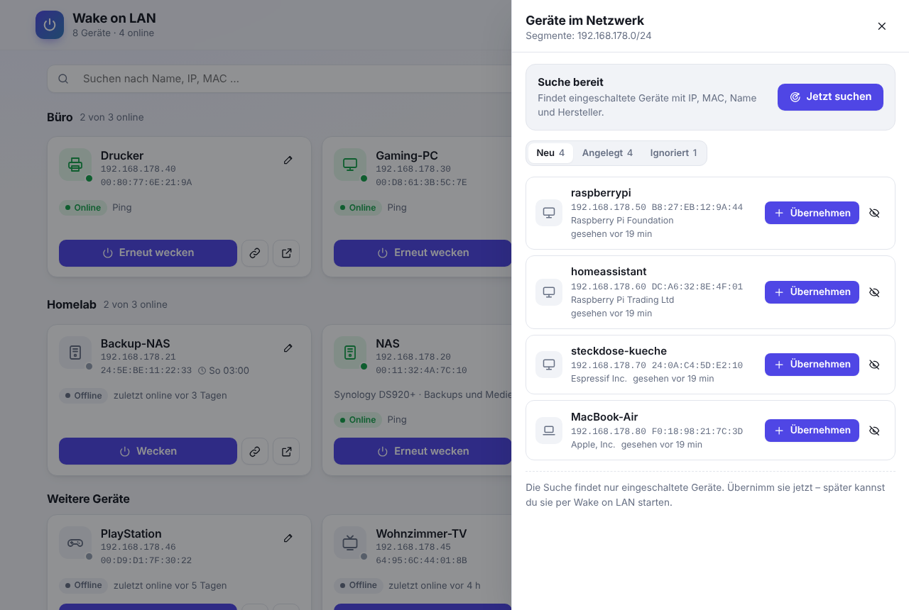
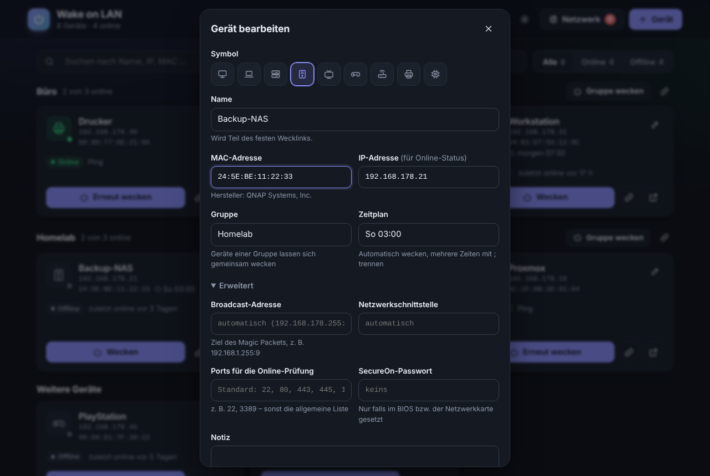
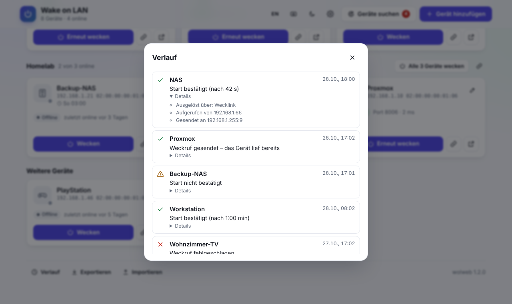
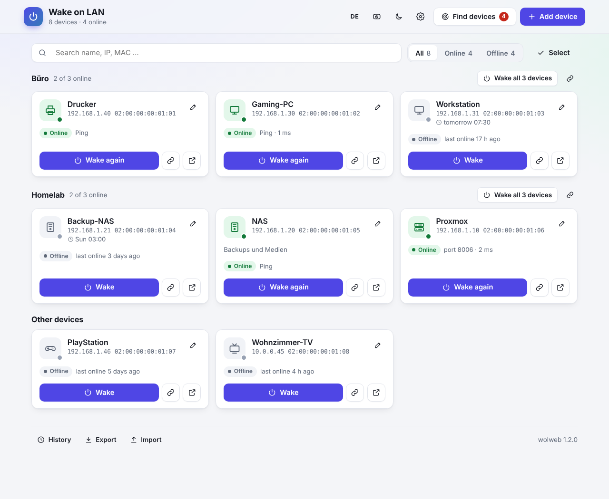
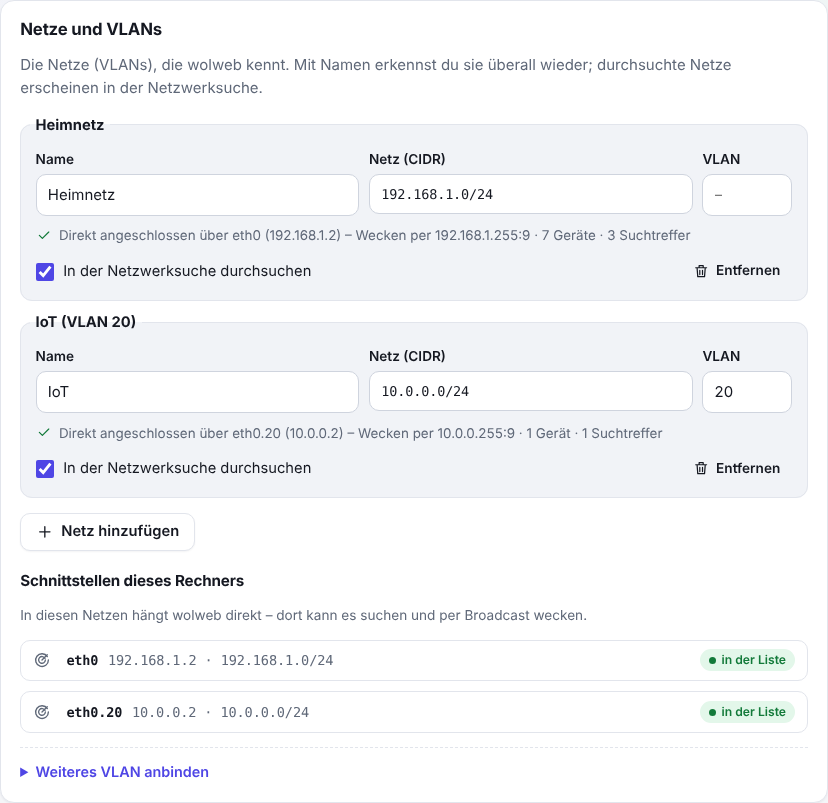

# wolweb

Wake on LAN mit Weboberfläche – Neufassung von [sameerdhoot/wolweb](https://github.com/sameerdhoot/wolweb) in Go,
als einzelne Datei ohne externe Abhängigkeiten im Browser.

[English](README.md) · **Deutsch**

## Schnellstart

**Voraussetzungen:** ein Rechner, der ständig läuft und im selben Netz hängt wie die Geräte, die geweckt werden
sollen – z. B. ein Raspberry Pi, ein NAS oder ein Proxmox-Container – mit Linux (für Docker: Docker mit Compose).
Auf den Zielrechnern muss Wake on LAN eingeschaltet sein (BIOS/UEFI, unter Windows zusätzlich bei der
Netzwerkkarte).

1. **Starten**

   mit Docker:

   ```sh
   git clone https://github.com/banit/wolweb.git && cd wolweb
   docker compose up -d --build
   ```

   oder ohne Docker: die passende Datei unter [Releases](https://github.com/banit/wolweb/releases) laden
   (z. B. `wolweb-1.3.0-linux-arm64` für einen Raspberry Pi 4/5) und starten:

   ```sh
   chmod +x wolweb-1.3.0-linux-arm64 && sudo ./wolweb-1.3.0-linux-arm64
   ```

2. **Öffnen:** `http://<Adresse>:8089` im Browser, z. B. `http://192.168.1.10:8089`.
3. **Gerät übernehmen:** den Zielrechner einschalten, „Geräte suchen“ → „Übernehmen“. Das Heimnetz erkennt wolweb
   selbst; Name, IP- und MAC-Adresse kommen aus der Suche.
4. **Wecklink kopieren:** Die neue Karte bietet „Wecklink kopieren“ und „Auf dem Handy einrichten“. Ab dann weckt
   das Öffnen von `http://<Adresse>:8089/wake/<Name>` den Rechner, und die Seite zeigt, wann er im Netzwerk antwortet.
5. **Richtig testen:** den Rechner herunterfahren (Strom und Netzwerkkabel bleiben dran), dann den Wecklink öffnen.
   Erst wenn die Seite das Gerät als erreichbar meldet, funktioniert Wake on LAN – ein Test am noch eingeschalteten
   Rechner beweist nichts.

Alles Weitere – Dauerbetrieb mit systemd, Update, mehrere Netze und VLANs, Konfiguration, Benachrichtigungen,
Metriken und die API – steht weiter unten.



<table>
<tr>
<td width="50%"></td>
<td width="50%"></td>
</tr>
<tr>
<td colspan="2" align="center"><sub>Fester Wecklink auf dem Handy: prüft, weckt und bestätigt den Start</sub></td>
</tr>
<tr>
<td></td>
<td></td>
</tr>
<tr>
<td></td>
<td></td>
</tr>
<tr>
<td align="center"><sub>Netzwerksuche · Verlauf</sub></td>
<td align="center"><sub>Gerätedialog (dunkel) · englische Oberfläche</sub></td>
</tr>
</table>

- **Übersicht** mit Online-Status jedes Geräts (Ping und TCP-Ports), Suche und Filter, hell/dunkel – Änderungen
  erscheinen sofort in jedem offenen Fenster (Server-Sent Events); Gruppen und Geräte in eigener Reihenfolge (per
  Ziehen oder mit Pfeilknöpfen)
- **Feste Wecklinks** `/wake/<Name>`: im Browser eine Bestätigungsseite, die das Gerät prüft, das Magic Packet
  sendet und den Start verfolgt, bis das Gerät wirklich online ist
- **Zuverlässiges Wecken**: Das Magic Packet geht dreimal innerhalb einer Sekunde an Port 9 und 7; antwortet ein
  Gerät mit IP nach 45 Sekunden noch nicht, schickt wolweb es von selbst noch einmal – auch bei Wecklinks,
  Gruppen und Zeitplänen, wenn niemand mehr zuschaut
- **Netzwerksuche**: findet eingeschaltete Geräte in freigegebenen Segmenten (IP, MAC, Hostname, Hersteller) –
  per Hand oder regelmäßig im Hintergrund; neue Geräte mit einem Klick übernehmen (Name aus dem Hostnamen, ohne Dialog; fehlt er, wird nur
  der Name gefragt) oder ignorieren
- **Einstellungsseite** mit Übersicht der Netze und VLANs (an welchen wolweb hängt, Geräte je Netz) und 17
  Akzentfarben; Änderungen gelten ohne Neustart
- **Passwort für Änderungen** (optional, ohne Benutzername): Ansehen und Wecken kann jeder im Netz, Ändern erst nach
  dem Entsperren; **Privatsphäre**: Online-Status – und getrennt davon, wann geweckt wurde – für alle, erst nach dem
  Entsperren oder für niemanden
- **Gruppen** („Homelab“, „Büro“), verwaltet in der Übersicht oder auf der Einstellungsseite, gemeinsam wecken, auch
  per festem Gruppen-Wecklink; **Zeitpläne** wie `Mo-Fr 07:30` wecken Geräte automatisch
- **Benachrichtigungen** per Webhook (JSON) oder ntfy aufs Handy, wenn ein Gerät online/offline geht oder
  geweckt wird; **Prometheus-Metriken** unter `/metrics`
- **Verlauf** in Worten: je Weckversuch ein Satz („Weckruf gesendet“, „Start bestätigt (nach 0:42 min)“, „Start nicht
  bestätigt“), wer, woher und wohin unter „Details“; **Export/Import** der Geräte als JSON
- **Deutsch und Englisch**: Die Oberfläche folgt der Sprache des Browsers und lässt sich oben rechts umschalten;
  auch die Meldungen der API kommen in der gewählten Sprache
- Übernimmt die `devices.json` und die Einstellungen des ursprünglichen wolweb (siehe
  [Umstieg](#umstieg-vom-ursprünglichen-wolweb))

## Geräte

Pflicht sind nur Name und MAC-Adresse. Die IP-Adresse braucht es für den Online-Status (sonst nimmt wolweb die IP
aus der Netzwerksuche).

| Feld | Wofür |
|---|---|
| Gruppe | Geräte mit gleicher Gruppe stehen zusammen und lassen sich gemeinsam wecken; vorhandene Gruppen stehen unter dem Feld zum Antippen. Mehrere Geräte auf einmal zuordnen: in der Übersicht „Auswählen“, Geräte ankreuzen, Gruppenname eingeben. Der Gruppenknopf nennt, wie viele er weckt („Alle 4 Geräte wecken“). Die Gruppen selbst – anlegen (auch leer), umbenennen, Mitglieder wählen, löschen – verwaltest du auf der Einstellungsseite unter „Gruppen“ oder mit dem Stift am Gruppenkopf |
| Zeitplan | „Automatisch wecken“ einschalten, Wochentage antippen, Uhrzeit wählen – der Dialog zeigt dazu „Montag bis Freitag um 07:30 Uhr“, das nächste Wecken und die Zeitzone. „Pausieren“ setzt den Zeitplan aus, ohne die Zeiten zu vergessen. Mehrere Zeiten gehen unter „Weitere Möglichkeiten“ als Text, z. B. `Mo-Fr 07:30; Sa,So 09:00`, `werktags 6:45`, `täglich 22:00` (englisch wie `Mon-Fri 07:30` geht auch; gespeichert wird einheitlich die deutsche Form) |
| *Erweitert:* Broadcast-Adresse | Ziel des Magic Packets, nur für Sonderfälle (sonst automatisch) |
| *Erweitert:* Netzwerkschnittstelle | Paket über genau diese Schnittstelle senden (Rechner mit mehreren Netzen) |
| *Erweitert:* Ports | eigene Ports für die Online-Prüfung statt der allgemeinen Liste |
| *Erweitert:* SecureOn-Passwort | 6 Byte, falls die Netzwerkkarte ein Passwort im Magic Packet verlangt |
| *Erweitert:* Notiz | freier Text auf der Karte |

Zeitpläne gelten in der Ortszeit des Rechners bzw. Containers (`TZ`, in `docker-compose.yml` voreingestellt).
Weicht sie von der Zeitzone des Browsers ab, sagt der Dialog das und nennt die Uhrzeit bei dir. Die Karte zeigt die
nächste geplante Weckzeit oder „Zeitplan pausiert“.

**Reihenfolge:** „Sortieren“ in der Übersicht zeigt Gruppen und Geräte als schlichte Liste. Ziehen geht am Griff (Maus,
Stift oder Finger – nur am Griff, damit die Seite auf dem Handy weiter blättert), alternativ mit den Pfeilknöpfen;
am Rand einer Gruppe wandert ein Gerät in die nächste, auch in leere Gruppen und zu „Weitere Geräte“. Jede Änderung
wird sofort gespeichert. Solange nichts sortiert ist, stehen Geräte nach Namen und Gruppen in der Reihenfolge, in
der sie angelegt wurden; neue Geräte kommen ans Ende ihrer Gruppe. Gruppen lassen sich auch auf der
Einstellungsseite mit Pfeilen umstellen.

## Feste Wecklinks

| Aufruf | Ergebnis |
|---|---|
| `http://host:8089/wake/NAS` im Browser | Weckseite mit Fortschritt: *Gerät prüfen → Weckruf senden → Auf Start warten → Online* (IP, MAC, Ziel und Ping/Port/ms unter „Technische Details“) |
| `curl http://host:8089/wake/NAS` | weckt sofort, Antwort JSON `{"success":true,"message":…}` (wie im Original) |
| `curl "http://host:8089/wake/NAS?wait=120"` | weckt und wartet bis zu 120 s, bis das Gerät antwortet (`"online": true/false`; fehlt, wenn keine IP bekannt ist) |
| `…/wake/NAS?format=html` / `?format=json` | Ausgabe erzwingen |
| `http://host:8089/wake-group/Homelab` | ganze Gruppe: im Browser eine Seite mit dem Start jedes Geräts, sonst JSON (auch `?wait=`) |

Der Name ist nicht von Groß-/Kleinschreibung abhängig. Nach dem Umbenennen gelten alte Links weiter: Browser
werden zur neuen Adresse geleitet, curl & Co. wecken direkt (wolweb merkt sich je Gerät bis zu zehn frühere Namen;
einen davon einem anderen Gerät zu geben, muss man bestätigen, danach gehört der Link dem neuen Gerät – ein Import
wählt stattdessen einen freien Namen). Auch umbenannte Gruppen behalten ihre alten Gruppen-Wecklinks, jeweils mit
dem Schlüssel, mit dem sie herausgegeben wurden. Die Bestätigung „online“ gibt es nur, wenn eine IP bekannt
ist (eingetragen oder aus der Netzwerksuche). Läuft das Gerät schon, sagt die Seite das und sendet nichts – außer
der Online-Status ist ausgeblendet ([Privatsphäre](#privatsphäre)): Dann weckt sie ohne diese Prüfung. Während
des Wartens nennt sie, wie lange geprüft wird (`status.wake_timeout`) und ob automatisch erneut gesendet wird. Kommt
keine Antwort, bleibt „Start nicht bestätigt“ mit dem Naheliegenden stehen (Strom, Netzwerkkabel, blockierte
Rückmeldung), dazu „Nochmals prüfen“ (ohne zu wecken), „Erneut wecken“ und technische Tipps unter „Hilfe“. Die
Übersicht zeigt die Warnung auf der Karte, bis das Gerät antwortet.
`HEAD`-Anfragen (Linkprüfer, Vorschauen in Messengern) wecken nie.

Tipp: Die Weckseite auf dem Handy „Zum Home-Bildschirm“ hinzufügen – dann weckt ein Tipp aufs Symbol das Gerät.
Nach dem Anlegen bietet die Karte dafür „Wecklink kopieren“ und „Auf dem Handy einrichten“ (kurze Anleitung für
iPhone und Android). Die Übersicht selbst lässt sich ebenso als App ablegen.

Online gilt ein Gerät, wenn es auf Ping antwortet oder einer der Ports (`status.ports`) eine Verbindung annimmt **oder
ablehnt** – eine Ablehnung kommt nur von einem laufenden Betriebssystem. Das gilt für Geräte im eigenen Netzsegment;
hinter einem Router zählt nur eine angenommene Verbindung oder Ping, weil dort auch eine Firewall stellvertretend
ablehnen kann.

Geprüft wird zuerst per Ping und mit der Methode, die beim letzten Mal geklappt hat; die übrigen Ports kommen erst
0,3 s später dran. Ein Gerät, das auf Ping antwortet, bekommt so keine einzige TCP-Verbindung (kein Rauschen im
SSH-Log). Pro Gerät lassen sich unter „Erweitert“ eigene Ports eintragen, z. B. `32400` für einen Plex-Server.

## Netzwerksuche

Einrichten muss man dafür meist nichts: Hängt der Rechner an genau einem Heimnetz, sucht wolweb dort von selbst
(Container-Brücken, VMs und VPNs zählen nicht). Hat er mehrere, fragt „Geräte suchen“ einmal: „Wähle das Netzwerk, in
dem dein Rechner steht“ – die Wahl landet in den Einstellungen. Fest vorgeben lassen sich die Netze in den
[Einstellungen](#einstellungen) unter „Netze und VLANs“ (oder in `discovery.networks` bzw. `WOLWEB_NETWORKS`, etwa
`192.168.1.0/24`); eine solche Angabe geht der Erkennung immer vor. Gesucht wird nur in Netzen, an denen der Rechner
direkt hängt – ARP und Wake on LAN gehen nicht über Router. Für weitere VLANs siehe
[Mehrere Netze und VLANs](#mehrere-netze-und-vlans).

- **Linux mit `CAP_NET_RAW`**: aktiver ARP-Scan – findet auch Geräte, die Ping und alle Ports blocken.
- **Sonst**: jede Adresse bekommt ein UDP-Paket, danach wird die Nachbartabelle gelesen (etwas ungenauer).
- Hostnamen aus Reverse-DNS, mDNS (Apple, Linux/Avahi, Drucker …) und NetBIOS (Windows, Samba),
  Hersteller aus der eingebetteten IEEE-Liste (Wireshark `manuf`).
- Ausgeschaltete Geräte findet keine Suche – Geräte also übernehmen, solange sie laufen.
- Treffer, die 30 Tage lang nicht mehr gesehen wurden, verschwinden aus der Liste (ignorierte bleiben).

## Installation

### Docker (empfohlen)

```sh
docker compose up -d --build
```

`docker-compose.yml` nutzt `network_mode: host` (nötig für Broadcasts und ARP) und gibt dem Container nur
`NET_RAW`. Daten liegen in `./data`. Docker Desktop (Windows/macOS) kann kein echtes Host-Netz, dort funktionieren
Wecken und Suche nicht.

wolweb läuft im Container als root, aber ohne jede Sonderberechtigung – es darf daher nur in Ordner schreiben, die
root gehören. Am einfachsten legt Docker `./data` beim ersten Start selbst an. Wer den Ordner vorher anlegt, etwa um
die alte `devices.json` zu übernehmen, gibt ihn root:

```sh
mkdir -p data && cp /pfad/zum/alten/devices.json data/legacy-devices.json
sudo chown -R root:root data
```

Die `legacy-devices.json` wird beim ersten Start übernommen.

Fertige Images für amd64, arm64 (Raspberry Pi 4/5) und armv7 baut GitHub bei jedem Release-Tag nach
`ghcr.io/banit/wolweb` (siehe `docker-compose.yml`). Selbst für mehrere Plattformen bauen:
`docker buildx build --platform linux/amd64,linux/arm64,linux/arm/v7 .`

### Direkt / Proxmox-LXC

```sh
CGO_ENABLED=0 GOOS=linux GOARCH=amd64 go build -trimpath -ldflags "-s -w -X main.version=1.3.0" -o wolweb .
```

Nach `/opt/wolweb` kopieren, `config.example.json` als `config.json` anpassen, `deploy/wolweb.service` nach
`/etc/systemd/system/` (Benutzer `wolweb` anlegen, `data/` beschreibbar machen), dann
`systemctl enable --now wolweb`. Die Unit gewährt nur `CAP_NET_RAW` für Ping und ARP-Scan, sonst nichts.

`wolweb -h` zeigt die Kommandozeilenoptionen (`-c` Konfigurationsdatei, `-d` devices.json des ursprünglichen wolweb,
`-healthcheck` für Docker, `-reset-password` siehe [Passwort für Änderungen](#passwort-für-änderungen)).

## Umstieg vom ursprünglichen wolweb

wolweb übernimmt Konfiguration und Geräteliste des ursprünglichen
[sameerdhoot/wolweb](https://github.com/sameerdhoot/wolweb) ohne Handarbeit:

- **Ohne Docker:** das neue Programm an die Stelle des alten setzen und mit derselben `config.json` und der alten
  Geräteliste starten: `./wolweb -c config.json -d devices.json`. Beim ersten Start landen die Geräte in
  `data/devices.json`; das alte Feld `ip` (z. B. `192.168.1.255:9`) wird zur Broadcast-Adresse des Geräts. Die alte
  Datei bleibt unverändert.
- **Mit Docker:** Das alte Image lief unter dem Pfad `/wolweb` (`WOLWEBVDIR=/wolweb`). Damit Lesezeichen und
  Automationen wie `http://host:8089/wolweb/wake/NAS` weiter funktionieren, in der neuen `docker-compose.yml`
  `WOLWEB_VDIR: "/wolweb"` setzen – sonst liegt alles direkt unter `/`. Die alte `devices.json` vor dem ersten Start
  als `data/legacy-devices.json` ablegen (siehe [Docker](#docker-empfohlen)); eine eigene `config.json` gehört nach
  `/config/config.json` (in `docker-compose.yml` vorbereitet).
- **Umgebungsvariablen** des Originals (`WOLWEBHOST`, `WOLWEBPORT`, `WOLWEBVDIR`, `WOLWEBBCASTIP`, `WOLWEBREADONLY`)
  gelten weiter.
- **Wecklinks** `/wake/<Name>` antworten curl, Skripten und Home Assistant wie bisher mit
  `{"success":…,"message":…}`; nur der Text der Meldung ist neu (Automationen also auf `"success"` prüfen). Im Browser
  kommt jetzt die Weckseite mit Startbestätigung. `/data/get` und `/health` gibt es weiterhin.
- **Online-Status:** Das Original kennt keine IP-Adressen der Geräte. Einmal „Geräte suchen“, während die Rechner
  eingeschaltet sind – wolweb ordnet die IP über die MAC-Adresse zu und zeigt ab dann, ob ein Gerät läuft.
- **Zurück:** Die alte `devices.json` bleibt unverändert; das alte Programm bzw. Image lässt sich jederzeit wieder
  starten.

## Update von 1.0.x / 1.1.x / 1.2.x

Geräte und Einstellungen werden beim ersten Start automatisch übernommen.

1. **Vor dem Update – nur wenn du wolweb ohne Anmeldung über eine eigene Domain aufrufst**, etwa hinter einem
   Reverse-Proxy (`https://wol.example.com`): diesen Namen zuerst freigeben. Seit 1.1 nimmt wolweb ohne Anmeldung nur
   IP-Adressen und lokale Namen (`nas`, `*.lan`, `*.local`, `*.fritz.box` …) an, als Schutz vor DNS-Rebinding; unter
   anderen Namen erscheint eine Seite, die erklärt, was zu tun ist. In `config.json` `"allowed_hosts":
   ["wol.example.com"]` eintragen (ältere Versionen übergehen den Schlüssel) bzw. in `docker-compose.yml`
   `WOLWEB_ALLOWED_HOSTS: "wol.example.com"`. Merkst du es erst danach: wolweb über seine IP-Adresse öffnen
   (`http://192.168.1.5:8089`) und den Namen in den Einstellungen unter „Sicherheit“ → „Weitere Hostnamen“ eintragen
   (zuletzt abgewiesene Namen stehen dort zur Auswahl – nur einen übernehmen, den du selbst eingerichtet hast). Beim
   Start steht außerdem ein Hinweis im Log.
2. **Aktualisieren:**
   - *Docker, aus dem Repository gebaut:* `git pull && docker compose up -d --build`. Wer `docker-compose.yml` selbst
     angepasst hat, vergleicht sie mit der neuen (siehe den Punkt *Docker* unter „Was sich mit 1.2 ändert“), statt sie
     zu überschreiben.
   - *Docker mit fertigem Image:* `docker compose pull && docker compose up -d`.
   - *Programmdatei mit systemd:* wolweb stoppen (`systemctl stop wolweb`), die Datei in `/opt/wolweb` ersetzen, wieder
     starten (`systemctl start wolweb`). `config.json` und `data/` bleiben, wie sie sind.
3. **Prüfen:** die Übersicht öffnen – unten steht die Version – und im Log (`docker logs wolweb` bzw.
   `journalctl -u wolweb`) nach der Zeile zur Sicherung und nach Hinweisen sehen.

**Sicherung und Weg zurück:** Bevor eine neue Version die Daten zum ersten Mal schreibt, legt sie eine Kopie an:
`data/backup-<alte Version>-<Datum>/` (etwa `backup-1.0.x-20261028-160512/` mit `devices.json`,
`discovered.json` und – ab 1.1 – `state.json` und `settings.json`). Das passiert einmal je Versionswechsel. Eine
ältere Version kann die neuen Dateien zwar lesen, verwirft beim nächsten Speichern aber, was sie nicht kennt
(SecureOn, Weckschlüssel, Gruppen, Zeitpläne, eigene Ports, Verlauf). Zurück geht es so: wolweb stoppen, die
Dateien aus dem Sicherungsordner nach `data/` kopieren, Dateien, die in der Sicherung fehlen (bei 1.0.x
`state.json` und `settings.json`), aus `data/` löschen, dann die alte Version starten. Was seit dem Update
geändert wurde, fehlt danach. Weckverlauf, „zuletzt geweckt“ und „zuletzt online“ in der `state.json` der Sicherung
folgen ebenfalls den Einstellungen zur [Privatsphäre](#privatsphäre): wolweb löscht sie dort nach der
Aufbewahrungsdauer bzw. sofort, wenn die Aufzeichnung aus ist. Geräte, Einstellungen und Suchtreffer bleiben in der
Sicherung, wie sie beim Update waren – alte Sicherungsordner löschen, sobald du sie nicht mehr brauchst.

**Was sich mit 1.3 ändert – und ob du etwas tun musst:**

- *Passwort für Änderungen* (neu, freiwillig): Solange keins gesetzt ist, ändert sich nichts. Mit Passwort bleiben
  Ansehen und Wecken frei; Bearbeiten, Import und Export, die Netzwerksuche und die Einstellungsseite gibt es erst
  nach dem Entsperren. Automationen mit `auth.api_token` sind nicht betroffen, die Anmeldung per HTTP Basic
  entsperrt nicht. Siehe [Passwort für Änderungen](#passwort-für-änderungen).
- *Gruppen sind eigene Einträge:* `devices.json` bekommt eine Liste `groups` (Name, Reihenfolge, frühere Namen),
  Geräte ein Feld `order`. Vorhandene Gruppen werden alphabetisch übernommen, wie bisher angezeigt; neue Gruppen
  kommen jetzt ans Ende, und eine leere Gruppe bleibt, bis du sie löschst (bisher verschwand sie mit ihrem letzten
  Gerät). `GET /api/v1/groups` nennt auch leere Gruppen, in ihrer Reihenfolge. Eine ältere Version verwirft
  `groups` und `order` beim Speichern – die Sicherung (siehe oben) enthält den Stand vor dem Update.
- *Akzentfarbe* (neu): Standard `indigo` wie bisher.
- *Privatsphäre* (neu): `privacy.online_status` blendet den Online-Status aus, `privacy.wake_history`, wann Geräte
  geweckt wurden; Standard jeweils `all` wie bisher.
- *Verlauf verfällt* (neu): Weckverlauf, „zuletzt geweckt“ und „zuletzt online“ werden jetzt nach 30 Tagen gelöscht
  (`privacy.retention_days`, bis 365); `privacy.recording: "off"` speichert nichts davon. Beim ersten Start
  verschwinden ältere Einträge des Verlaufs – die Sicherung (siehe oben) enthält sie noch.

**Was sich mit 1.2 ändert – und ob du etwas tun musst:**

- *Netzwerksuche ohne eingetragenes Netz:* Bisher war sie dann aus. Jetzt nimmt wolweb das eine direkt
  angeschlossene Heimnetz von selbst und sucht dort alle 30 Minuten (`discovery.interval`). Soll das nicht sein:
  `discovery.interval` auf `0` setzen (Einstellungsseite oder `WOLWEB_SCAN_INTERVAL=0`). Mit mehreren Netzen bietet
  die Suchleiste eine Auswahl an; ein eingetragenes Netz geht wie bisher vor.
- *Benachrichtigungen folgen keinen Weiterleitungen mehr:* Leitet die Webhook- oder ntfy-Adresse weiter (etwa
  `http://` → `https://`), trage die endgültige Adresse ein – „Testnachricht senden“ zeigt, ob es klappt.
- *Kein doppeltes Wecken:* Ein zweiter Weckruf für dasselbe Gerät innerhalb von 10 Sekunden wird nicht gesendet,
  sondern mit `"already": true` beantwortet – auf allen Wegen. Automationen, die absichtlich kurz hintereinander
  zweimal wecken, brauchen das nicht mehr (wolweb sendet jeden Weckruf ohnehin dreimal und wiederholt ihn bei
  Bedarf selbst).
- *Neue Felder in den Daten:* `schedule_paused` und `aliases` (frühere Namen) bei Geräten, dazu Angaben zum
  Ergebnis im Verlauf. Eine ältere Version verwirft sie beim Speichern – Pausen, alte Wecklinks und die Sätze im
  Verlauf gingen dann verloren; die Sicherung (siehe oben) enthält den Stand vor dem Update.
- *Meldungen der API:* sagen jetzt „Weckruf“ statt „Magic Packet“ (z. B. `"message": "Weckruf an NAS gesendet."`).
  Wer in einer Automation auf den genauen Text prüft, sollte auf `"success"` umstellen.
- *Standardsprache Englisch:* `language` steht jetzt auf `en`. Die Oberfläche folgt weiter dem Browser; englisch
  werden ohne Einstellung aber Benachrichtigungen (Webhook, ntfy) und Antworten an Aufrufe ohne Sprachangabe
  (curl, Home Assistant). Deutsch behalten: `"language": "de"` in `config.json`, `WOLWEB_LANGUAGE=de` oder
  „Standardsprache“ auf der Einstellungsseite. Das Log ist jetzt englisch, der Sicherungsordner heißt `backup-…`.
  Auch technische Statusfelder ändern sich: `method` lautet `tcp/445 (refused)` statt `tcp/445 (abgelehnt)`, und der
  Hinweis auf einen IP-Konflikt (`note`) ist immer englisch – Automationen mit solchen Textvergleichen anpassen.
- *Docker:* Die neue `docker-compose.yml` setzt `WOLWEB_NETWORKS` und `WOLWEB_SCAN_INTERVAL` nicht mehr (nur noch
  als Beispiel auskommentiert) – das Netz wird erkannt, und die Felder auf der Einstellungsseite sind nicht mehr
  gesperrt. Wer sein Netz dort fest vorgegeben hatte und das behalten will, übernimmt die Zeile in die neue Datei.
  Zeitpläne laufen in der Zeitzone des Containers (`TZ`, voreingestellt); weicht sie vom Browser ab, sagt das der
  Gerätedialog.

## Einstellungen

Das Zahnrad oben rechts öffnet die Einstellungsseite (`/settings`). Dort lassen sich die Netze und VLANs,
Netzwerksuche, Online-Prüfung, Wartezeiten, Benachrichtigungen (mit „Testnachricht senden“), öffentliche Wecklinks,
erlaubte Hostnamen, wer den Online-Status sieht und wann geweckt wurde ([Privatsphäre](#privatsphäre)), die
Standardsprache und die
Akzentfarbe ändern (17 Farben, jeweils hell und dunkel). Änderungen gelten sofort, ohne Neustart. Gruppen und das
Passwort für Änderungen haben dort eigene Bereiche, die sofort speichern.

- **Reihenfolge** (das Spätere gewinnt): Standardwerte, `config.json`, die Einstellungsseite, Umgebungsvariablen.
- **Gespeichert** wird in `data/settings.json` – im Datenverzeichnis, weil das immer beschreibbar ist (`config.json`
  ist in Docker oft schreibgeschützt eingebunden). Dort steht nur, was von `config.json` abweicht; spätere
  Änderungen an `config.json` wirken also weiter, solange man denselben Wert nicht auch auf der Seite geändert hat.
  „Auf config.json zurücksetzen“ löscht die Datei wieder.
- **Gesperrt**: Was per Umgebungsvariable gesetzt ist (in Docker etwa `WOLWEB_NETWORKS`), zeigt die Seite
  ausgegraut mit dem Namen der Variable. Wer es lieber auf der Seite pflegt, nimmt die Variable heraus.
- **Nicht auf der Seite**: Adresse, Port, Pfad, Datenverzeichnis, Nur-Lesen und die Zugangsdaten. Über die Seite
  könnte man sich sonst aussperren – oder ohne Anmeldung einfach eine setzen.
- Ohne Anmeldung und ohne [Passwort für Änderungen](#passwort-für-änderungen) kann jeder im Netz die Einstellungen
  sehen und ändern; die Seite weist darauf hin. Im Nur-Lesen-Modus lässt sie sich nur ansehen.



### Passwort für Änderungen

Unten auf der Einstellungsseite lässt sich ein Passwort für Änderungen setzen – ohne Benutzernamen. Mit Passwort:

- **Ansehen und Wecken bleiben frei** für alle im Netz: Übersicht, Status, Weckknöpfe, Gruppen wecken und die festen
  Wecklinks.
- **Alles andere erst nach dem Entsperren**: Geräte anlegen, bearbeiten und löschen, Gruppen zuordnen, Import und
  Export, die Netzwerksuche („Geräte suchen“ und die Suchtreffer erscheinen erst nach dem Entsperren) und die
  Einstellungsseite. Das Schloss in der Kopfzeile fragt nach dem Passwort; danach bleibt dieser Browser entsperrt,
  bis er geschlossen wird oder 12 Stunden lang nichts bearbeitet wird (eine bloß offene Übersicht zählt nicht).
  Derselbe Knopf sperrt sofort wieder.
- Ändern oder Entfernen verlangt das bisherige Passwort; ein neues Passwort beendet die Entsperrung aller anderen
  Browser. Nach 5 Fehlversuchen aus einem Browser heißt es für ihn 30 s warten (mit jedem weiteren Fehlversuch
  doppelt so lange, höchstens 15 Minuten); hinter einem Reverse-Proxy unterscheidet der letzte Eintrag von
  `X-Forwarded-For` die Browser. Nach 30 Fehlversuchen insgesamt gilt die Wartezeit für alle, und es läuft immer nur
  eine Passwortprüfung zur Zeit.
- Gespeichert wird nur ein PBKDF2-SHA256-Hash in `data/state.json`; die Entsperrung ist ein signiertes Cookie
  (HttpOnly, SameSite=Strict).
- Automationen mit `auth.api_token` sind nicht betroffen. Die Anmeldung per HTTP Basic entsperrt nicht – die kennt
  oft der ganze Haushalt, das Passwort für Änderungen ist für weniger Leute gedacht.
- **Vergessen?** wolweb anhalten und einmal mit `-reset-password` starten: Das entfernt das Passwort und beendet sich.

  ```sh
  docker compose stop wolweb
  docker compose run --rm wolweb -reset-password
  docker compose start wolweb
  ```

  Ohne Docker: den Dienst anhalten, `wolweb -c config.json -reset-password` mit derselben Konfiguration ausführen
  (damit es das Datenverzeichnis findet) und den Dienst wieder starten.

### Privatsphäre

Unter „Privatsphäre“ auf der Einstellungsseite legst du fest, wer sieht, ob Geräte laufen (`privacy.online_status`):

| Auswahl | Wert | Wer sieht den Online-Status |
|---|---|---|
| Für alle anzeigen (Standard) | `all` | jeder, der wolweb aufruft |
| Nur nach dem Entsperren anzeigen | `unlocked` | nur Browser, die mit dem [Passwort für Änderungen](#passwort-für-änderungen) entsperrt sind, und Automationen mit `auth.api_token` – etwa zur Fehlersuche. Ohne Passwort für Änderungen sieht ihn niemand. |
| Für niemanden anzeigen | `none` | niemand, auch nicht nach dem Entsperren |

Ausgeblendet heißt überall, nicht nur in der Übersicht: Die Karten zeigen keinen Status, keinen grünen Punkt und
kein „Erneut wecken“, der Filter Online/Offline entfällt, und Gruppen nennen nur die Zahl ihrer Geräte. Der Server
lässt den Status aus `/api/v1/devices` und `/api/v1/groups`, den Live-Ereignissen, `/metrics` und dem Verlauf weg;
die `…/status`-Aufrufe antworten 403 mit `"hidden": true`. **Ausnahme Wecken:** Wer ein Gerät weckt – per Knopf in
der Übersicht oder über seinen Weck- oder Gruppenlink –, startet es ohnehin und sieht deshalb weiter, ob es
hochkommt. Die Karte in der Übersicht verfolgt den Start dieses einen Geräts und blendet den Status danach wieder
aus; Weck- und Gruppenseiten bestätigen den Start wie gewohnt. Die Weckantwort bringt dafür einen kurzlebigen
Schlüssel `watch` mit, den `…/status?watch=…` 15 Minuten lang für dieses Gerät bzw. diese Gruppe annimmt, und
`?wait=` funktioniert weiter. Nur die Vorabprüfung, ob das Gerät schon läuft, entfällt – sie verriete den Status,
ohne zu wecken. Auch die Suchtreffer verraten, wer im Netz ist; mit Passwort für Änderungen sehen sie nur
Entsperrte, egal wie eingestellt. Geprüft wird im Hintergrund weiter, für die automatische Wiederholung und die
Benachrichtigungen (deren Ereignisse wählst du getrennt). Die Anmeldung per HTTP Basic zählt
nicht als entsperrt, wie beim Passwort für Änderungen.

**„Zuletzt geweckt“ und Verlauf** (`privacy.wake_history`): eine eigene Auswahl unter dem Online-Status, mit denselben
drei Stufen und `all` als Standard – solange du nichts anderes wählst, ändert sich nichts. Sie blendet aus, wann
Geräte geweckt wurden: „geweckt vor …“ auf den Karten, den Knopf „Verlauf“ (`/api/v1/history` antwortet 403 mit
`"hidden": true`), `last_wake` in der API und die Kennzahlen `wolweb_device_last_wake_timestamp_seconds` und
`wolweb_wakes_total`. Bei `unlocked` sehen entsperrte Browser und das API-Token alles weiter. Das Wecken bleibt
unberührt: Wer ein Gerät weckt, verfolgt seinen Weckruf wie gewohnt, und der Verlauf wird weiter aufgezeichnet –
stellst du zurück, ist er wieder zu sehen.

**Aufzeichnung und Aufbewahrung** (`privacy.recording`, `privacy.retention_days`): Weckverlauf, „zuletzt geweckt“ und
„zuletzt online“ sind personenbezogen – wer wann ein Gerät geweckt hat, wann ein Arbeitsplatz lief. wolweb löscht sie
nach der eingestellten Zahl von Tagen (1 bis 365, Standard 30): Die Seiten lassen Älteres sofort weg, `state.json`
wird alle fünf Minuten bereinigt. Ohne Haken bei „Weckverlauf und „zuletzt online“ aufzeichnen“
(`recording: "off"`) löscht wolweb sie nach einer Rückfrage sofort und speichert ab dann nichts davon; der Knopf
„Verlauf“ entfällt. Wecken und Startbestätigung funktionieren in beiden Fällen weiter. Das Server-Log
(`docker logs wolweb`, `journalctl -u wolweb`) ist davon nicht betroffen – das führen Docker bzw. journald; dort lässt
es sich bei Bedarf begrenzen.

## Mehrere Netze und VLANs

Magic Packets sind Broadcasts, und die Netzwerksuche fragt per ARP – beides geht nicht über Router. wolweb braucht
deshalb in jedem Netz, in dem es wecken und suchen soll, **eine eigene Schnittstelle**: meist ein zusätzliches
Interface mit VLAN-Tag auf dem Rechner, auf dem wolweb läuft. Ist es angelegt, erscheint es in den Einstellungen
unter „Schnittstellen dieses Rechners“; „Übernehmen“ trägt das Netz ein, dazu ein Name („IoT“) und die VLAN-ID.
Geräte darin weckt wolweb über die richtige Schnittstelle (die Broadcast-Adresse folgt aus der IP des Geräts), und
die Suche findet sie. Für Geräte ohne IP schlägt der Gerätedialog unter „Erweitert → Broadcast-Adresse“ die
Broadcasts der eingetragenen Netze vor.

Voraussetzung: Der Switch-Port bzw. die Bridge des Rechners reicht das VLAN getaggt durch (Trunk), und wolweb hat im
VLAN eine eigene, feste Adresse (außerhalb des DHCP-Bereichs oder per DHCP-Reservierung). **Kein Gateway** auf den
zusätzlichen Schnittstellen eintragen – die Standardroute bleibt im Hauptnetz.

**Proxmox (LXC):** Dem Container eine zweite Netzwerkkarte mit VLAN-Tag geben – in der Oberfläche unter
*Container → Netzwerk → Hinzufügen* (Bridge `vmbr0`, VLAN-Tag `20`, IPv4 statisch, Gateway leer) oder auf dem Host:

```sh
pct set 105 -net1 name=eth1,bridge=vmbr0,tag=20,ip=10.0.0.5/24
```

Die Bridge muss „VLAN aware“ sein (*Host → System → Netzwerk → vmbr0 → VLAN aware*, bzw. `bridge-vlan-aware yes` in
`/etc/network/interfaces`). Bei einer VM entsprechend eine weitere Netzwerkkarte mit VLAN-Tag hinzufügen.

**Debian, Raspberry Pi OS, Ubuntu (direkt oder als Docker-Host):** VLAN-Interface anlegen. Zum Ausprobieren:

```sh
sudo ip link add link eth0 name eth0.20 type vlan id 20
sudo ip addr add 10.0.0.5/24 dev eth0.20
sudo ip link set eth0.20 up
```

Dauerhaft mit NetworkManager (Raspberry Pi OS ab Bookworm, Ubuntu Desktop):

```sh
sudo nmcli con add type vlan con-name vlan20 dev eth0 id 20 \
  ipv4.method manual ipv4.addresses 10.0.0.5/24 ipv4.never-default yes ipv6.method disabled
```

mit ifupdown (Debian, Paket `vlan`) in `/etc/network/interfaces.d/vlan20`:

```
auto eth0.20
iface eth0.20 inet static
    address 10.0.0.5/24
```

mit netplan (Ubuntu Server) in `/etc/netplan/60-vlan20.yaml`, danach `sudo netplan apply`:

```yaml
network:
  version: 2
  vlans:
    vlan20:
      id: 20
      link: eth0
      addresses: [10.0.0.5/24]
```

**Docker:** Mit `network_mode: host` (wie in `docker-compose.yml`) sieht wolweb alle Schnittstellen des Hosts –
das VLAN-Interface also wie oben auf dem Host anlegen, am Container ändert sich nichts. Ohne Host-Netz geht es mit
je einem macvlan-Netz pro VLAN (`docker network create -d macvlan -o parent=eth0.20 --subnet 10.0.0.0/24 vlan20`),
das ist aber umständlicher. Docker Desktop (Windows, macOS) kann beides nicht.

**Absichern:** Eine Schnittstelle in einem abgeschotteten Netz (IoT, Gäste) macht wolweb auch von dort erreichbar.
Mit `host` in `config.json` (bzw. `WOLWEB_HOST`) die Weboberfläche nur an die Adresse im Hauptnetz binden, z. B.
`"host": "192.168.1.5"` – Wecken und Suche im VLAN funktionieren trotzdem.

Geht keine eigene Schnittstelle, zeigt die Einstellungsseite das Netz als „nicht direkt angeschlossen“ und weckt
Geräte darin per gerichtetem Broadcast (z. B. `10.0.0.255:9`). Ankommen wird er nur, wenn der Router ihn ins
VLAN weiterleitet – bei OPNsense und pfSense etwa mit dem Plugin „UDP Broadcast Relay“; die meisten Heimrouter
können das nicht, und suchen lässt sich dort ohnehin nicht.

**Einzelne Geräte hinter dem Router (Unicast):** Für ein einzelnes Gerät in einem anderen Netz geht es auch ohne
eigene Schnittstelle und ohne Broadcast-Weiterleitung: wolweb schickt den Weckruf direkt an die IP-Adresse des
Geräts, und der Router leitet ihn weiter wie jedes andere Paket. Damit das auch klappt, während das Gerät schläft,
braucht der Router drei Dinge:

1. eine **feste IP-Adresse** für das Gerät (DHCP-Reservierung),
2. einen **statischen ARP-Eintrag** (IP-Adresse → MAC-Adresse des Geräts) im Netz des Geräts. Ein schlafendes Gerät
   beantwortet keine ARP-Anfragen; ohne festen Eintrag verwirft der Router den Weckruf, sobald er die MAC-Adresse
   vergessen hat – meist schon wenige Minuten nach dem Einschlafen. Bei OPNsense unter *Interfaces → Neighbors*
   (deutsch *Schnittstellen → Nachbarn*), bei pfSense über die Option für einen statischen ARP-Eintrag in der
   DHCP-Reservierung. Viele Heimrouter bieten das nicht an.
3. eine **Firewall-Regel** vom wolweb-Rechner zum Gerät für UDP an Port 9 und 7 (wolweb sendet an beide), dazu Ping
   oder einen der geprüften Ports, damit wolweb den Start bestätigen kann.

In wolweb dann beim Gerät unter „Erweitert → Broadcast-Adresse“ die IP-Adresse des Geräts mit Port eintragen, z. B.
`10.0.0.20:9`. Die Netzwerksuche findet solche Geräte nicht – die MAC-Adresse also von Hand eintragen (sie steht in
den Netzwerkeinstellungen des Geräts oder in der ARP- bzw. DHCP-Übersicht des Routers). Als gestartet gilt das Gerät
hier erst, wenn es auf Ping antwortet oder eine Verbindung annimmt (siehe [Feste Wecklinks](#feste-wecklinks)).

## Konfiguration

`config.json` (siehe `config.example.json`) – alles hat Standardwerte, die Datei darf fehlen. Was auf der
[Einstellungsseite](#einstellungen) geändert wurde, gilt vor der Datei; Umgebungsvariablen gehen allem vor. Wo zwei
Variablennamen stehen, ist der erste der des ursprünglichen wolweb – beide funktionieren.

| Schlüssel | Variable | Standard | Bedeutung |
|---|---|---|---|
| `host`, `port` | `WOLWEBHOST` / `WOLWEB_HOST`, `WOLWEBPORT` / `WOLWEB_PORT` | `0.0.0.0`, `8089` | Adresse der Weboberfläche |
| `vdir` | `WOLWEBVDIR` / `WOLWEB_VDIR` | `/` | Unterpfad, z. B. `/wolweb` hinter einem Reverse-Proxy |
| `bcastip` | `WOLWEBBCASTIP` / `WOLWEB_BCASTIP` | automatisch | Standardziel, wenn weder Gerät noch Netz eins liefern |
| `read_only` | `WOLWEBREADONLY` / `WOLWEB_READONLY` | `false` | nur wecken, nichts ändern |
| `language` | `WOLWEB_LANGUAGE` | `en` | `en` oder `de`: Sprache, wenn weder Umschalter noch Browser eine nennen (auch für Benachrichtigungen) |
| `accent` | `WOLWEB_ACCENT` | `indigo` | Akzentfarbe der Oberfläche (Knöpfe, Auswahl, Markierungen) auf allen Seiten: indigo, blue, sky, cyan, teal, emerald, green, lime, amber, orange, red, rose, pink, fuchsia, purple, violet, slate – am einfachsten auf der Einstellungsseite gewählt |
| `data_dir` | `WOLWEB_DATA_DIR` | `data` | Geräte (`devices.json`), Laufzeitdaten (`state.json`), Suchergebnisse (`discovered.json`) und Änderungen der Einstellungsseite (`settings.json`) |
| `discovery.networks` | `WOLWEB_NETWORKS` | automatisch | Netze (CIDR, Variable kommagetrennt); leer = das eine Heimnetz automatisch, bei mehreren Auswahl in der Oberfläche; auch mit Namen: `{"cidr": "10.0.0.0/24", "name": "IoT", "vlan": 20, "scan": false}` – `scan: false` heißt anzeigen, aber nicht durchsuchen |
| `discovery.interval` | `WOLWEB_SCAN_INTERVAL` | `30m` | automatische Suche, `0` = aus (mindestens `1m`) |
| `discovery.max_hosts` | – | `1024` | größtes erlaubtes Segment |
| `status.interval` | `WOLWEB_STATUS_INTERVAL` | `30s` | Online-Prüfung aller Geräte, `0` = aus (mindestens `5s`) |
| `status.ports` | – | 22, 80, 443, 445, … | Ports für die Online-Prüfung |
| `status.wake_timeout` | `WOLWEB_WAKE_TIMEOUT` | `3m` | so lange wartet die Weckseite (`5s` bis `10m`) |
| `status.wake_retry` | `WOLWEB_WAKE_RETRY` | `45s` | antwortet ein geweckter Rechner so lange nicht, geht der Weckruf einmal erneut raus; `0` = nie |
| `auth.username/password` | `WOLWEB_USER`, `WOLWEB_PASSWORD` | – | Anmeldung (HTTP Basic) |
| `auth.api_token` | `WOLWEB_TOKEN` | – | `Authorization: Bearer …` für Automationen |
| `auth.public_wake` | `WOLWEB_PUBLIC_WAKE` | `true` | Wecklinks funktionieren ohne Anmeldung |
| `auth.wake_keys` | `WOLWEB_WAKE_KEYS` | `false` | Wecklinks ohne Anmeldung nur mit dem Schlüssel des Geräts (`?key=…`) |
| `allowed_hosts` | `WOLWEB_ALLOWED_HOSTS` | – | weitere Hostnamen, unter denen wolweb erreichbar ist (siehe Sicherheit) |
| `notify.webhook` | `WOLWEB_WEBHOOK` | – | URL, die jedes Ereignis als JSON per POST bekommt |
| `notify.ntfy` | `WOLWEB_NTFY` | – | ntfy-Thema, z. B. `https://ntfy.sh/mein-geheimes-thema` |
| `notify.events` | `WOLWEB_NOTIFY_EVENTS` | alle | Auswahl aus `online`, `offline`, `wake`, `wake_failed` |
| `privacy.online_status` | `WOLWEB_ONLINE_STATUS` | `all` | wer sieht, ob Geräte laufen: `all`, `unlocked` (nur nach dem Entsperren) oder `none` (siehe [Privatsphäre](#privatsphäre)) |
| `privacy.wake_history` | `WOLWEB_WAKE_HISTORY` | `all` | wer sieht, wann Geräte geweckt wurden („geweckt vor …“, Verlauf): `all`, `unlocked` oder `none` |
| `privacy.recording` | `WOLWEB_RECORDING` | `on` | `off` = keinen Weckverlauf, kein „zuletzt geweckt“ und kein „zuletzt online“ speichern (Vorhandenes wird gelöscht) |
| `privacy.retention_days` | `WOLWEB_RETENTION_DAYS` | `30` | nach wie vielen Tagen Weckverlauf, „zuletzt geweckt“ und „zuletzt online“ gelöscht werden (1–365) |

`devices.json` enthält nur, was man selbst einträgt; was wolweb beobachtet (zuletzt geweckt, zuletzt online, bis
zu 500 Weckversuche der letzten `privacy.retention_days` Tage) steht in `state.json`. Der Export unten auf der Seite sichert die Geräte samt
Wecklink-Schlüsseln. Für eine vollständige Sicherung oder einen Umzug wolweb stoppen und das ganze Datenverzeichnis
und die `config.json` kopieren – und die Umgebungsvariablen aufheben, mit denen wolweb eingestellt ist.

Die Broadcast-Adresse eines Geräts wird automatisch aus dem Netz seiner IP bestimmt; nur bei Sonderfällen im
Gerät unter „Erweitert“ eintragen. Ist keine IP bekannt, gilt `bcastip`, ohne Einstellung die Broadcast-Adresse des
Suchsegments (wenn genau eins eingetragen ist), sonst `255.255.255.255:9`. Ist am Gerät eine Netzwerkschnittstelle
eingetragen, verlässt das Paket den Rechner unter Linux auch wirklich über diese Schnittstelle.

Ein Magic Packet ist ein einzelnes UDP-Paket ohne Bestätigung – geht es verloren (WLAN-Brücke, ein Switch-Port im
Energiesparmodus), merkt das niemand. wolweb schickt es deshalb dreimal im Abstand von 0,4 Sekunden, und zwar an
Port 9 und Port 7, auf die Netzwerkkarten je nach Hersteller hören (ein anderer eingetragener Port, etwa für eine
Weiterleitung im Router, bleibt allein). Antwortet ein Gerät mit IP-Adresse nach `status.wake_retry` (45 s) noch
nicht, geht das Paket einmal erneut raus; im Verlauf steht das als „automatische Wiederholung“. Wird das Gerät in
der Zwischenzeit noch einmal geweckt, zählt die Frist von vorn.

## Benachrichtigungen und Metriken

Mit `notify.webhook` bekommt eine URL jedes Ereignis als JSON, z. B. für einen Home-Assistant-Webhook oder Node-RED:

```json
{"event":"online","device":"NAS","id":"3fa2b1c4d5e6","ip":"192.168.1.20","message":"NAS ist online (icmp)","time":"…"}
```

Mit `notify.ntfy` kommt eine Push-Nachricht aufs Handy (App „ntfy“, Thema abonnieren). Gemeldet werden nur echte
Wechsel online ↔ offline, nicht das erste Ergebnis nach dem Start.

wolweb schickt Benachrichtigungen genau an die eingetragene Adresse – auch an Server im eigenen Netz, etwa ein
selbst gehostetes ntfy oder Home Assistant. **Weiterleitungen folgt es nicht**: Antwortet das Ziel mit einer
Umleitung (3xx), geht die Nachricht nicht weiter, sondern es steht ein Fehler im Log. Sonst könnte ein umgeleiteter
Server die Nachricht an ein Ziel schicken lassen, das niemand eingetragen hat. Abhilfe: die endgültige Adresse direkt
eintragen (z. B. mit `https://` statt `http://`). „Testnachricht senden“ sagt nur „zugestellt“ oder „nicht
zugestellt“ – den Grund nennt das Log (`docker logs wolweb` bzw. `journalctl -u wolweb`). Technische Einzelheiten zu
internen Zielen zeigt die Seite damit nicht; ob eine Adresse die Nachricht angenommen hat, sieht natürlich weiterhin,
wer die Einstellungsseite benutzen darf.

`/metrics` liefert Kennzahlen im Prometheus-Format (`wolweb_device_up`, `wolweb_device_rtt_seconds`,
`wolweb_device_last_seen_timestamp_seconds`, `wolweb_device_last_wake_timestamp_seconds`, `wolweb_wakes_total`,
`wolweb_discovery_found` …). Mit Anmeldung braucht auch der Abruf sie – in Prometheus
`authorization: {credentials: <api_token>}`. Ist der Online-Status ausgeblendet ([Privatsphäre](#privatsphäre)),
bleiben `wolweb_device_up`, `wolweb_device_rtt_seconds` und `wolweb_device_last_seen_timestamp_seconds` leer – bei
`unlocked` bringt das Token sie zurück. `privacy.wake_history` macht dasselbe mit
`wolweb_device_last_wake_timestamp_seconds` und `wolweb_wakes_total`.

## Sicherheit

- **Anmeldung**: `auth.username`/`auth.password` (HTTP Basic, im Internet nur hinter HTTPS) und/oder `auth.api_token`
  für Automationen.
- **Passwort für Änderungen**: Ansehen und Wecken bleiben frei, Ändern erst nach dem Entsperren – siehe
  [Passwort für Änderungen](#passwort-für-änderungen).
- **Online-Status und Weckverlauf**: Wer sieht, ob Geräte laufen und wann sie geweckt wurden – alle, nur nach dem
  Entsperren oder niemand –, siehe [Privatsphäre](#privatsphäre).
- **Öffentliche Wecklinks** (`auth.public_wake`): Mit Anmeldung bleiben `/wake/<Name>` und die Weckseite ohne Login
  erreichbar. Damit niemand Geräte über erratene Namen weckt, verlangt `auth.wake_keys` zusätzlich einen Schlüssel
  je Gerät – „Wecklink kopieren“ hängt ihn an (`/wake/NAS?key=…`), im Gerätedialog lässt er sich erneuern (Gruppenschlüssel im Gruppendialog). Eine gelöschte und gleichnamig neu angelegte Gruppe bekommt einen neuen Schlüssel.
- **Kein doppeltes Wecken**: Jedes Gerät bekommt höchstens alle 10 s einen Weckruf – mit und ohne Anmeldung, über
  Wecklink, Gruppenlink, Weckseite und API gemeinsam. Ein zweiter Aufruf in dieser Zeit (zweimal getippt, Seite neu
  geladen) ist kein Fehler: Er meldet „wird bereits geweckt“ (`"already": true`) und die Seite verfolgt den
  laufenden Start, ohne erneut zu senden. Zeitpläne und die automatische Wiederholung werden nie gebremst.
- **Wecklinks von fremden Seiten**: Ein Wecklink weckt beim Öffnen – mit Absicht, auch wenn er auf einer anderen
  Seite steht (Home-Assistant-Dashboard, Glance, Lesezeichenseite). Das heißt aber auch: Jede Webseite, die du
  besuchst, kann deinen Browser zu `/wake/<Name>` oder `/wake-group/<Name>` schicken, und die ausgelieferte
  Weckseite weckt dann. Mehr als Wecken ist so nicht möglich, und `HEAD` (Linkvorschauen in Messengern, Linkprüfer)
  weckt nie. Wer auch das verhindern will, schaltet die Anmeldung samt `auth.wake_keys` ein: Dann braucht jeder
  Link – Gerät wie Gruppe gleichermaßen – den Schlüssel, den „Wecklink kopieren“ anhängt, und Namen lassen sich
  nicht erraten. Ein bei wolweb angemeldeter Browser braucht keinen Schlüssel; schickt ihn eine fremde Webseite
  ohne Schlüssel auf einen Wecklink, weckt die Weckseite erst auf Knopfdruck. Das ist eine bewusste Ausnahme vom Schutz gegen Cross-Site-Anfragen: Wecklinks sollen von überall
  funktionieren, jede andere Änderung braucht die Seite von wolweb selbst oder ein Token.
- **DNS-Rebinding**: Ohne Anmeldung nimmt wolweb nur Aufrufe unter IP-Adressen, Namen ohne Punkt (`nas`), lokalen
  Endungen (`.lan`, `.local`, `.home`, `.internal`, `.home.arpa`, `.fritz.box` …) und den Namen aus
  `allowed_hosts` an (`"wol.example.com"`, `"*.example.com"`, `"*"` schaltet die Prüfung ab). Sonst könnte eine
  fremde Webseite ihren Namen auf die IP von wolweb umbiegen und die API im Browser fernsteuern. Mit Anmeldung wird
  nur geprüft, wenn `allowed_hosts` gesetzt ist. Hinter einem Reverse-Proxy soll dieser den ursprünglichen Hostnamen
  weitergeben (nginx: `proxy_set_header Host $host;`, Apache: `ProxyPreserveHost On`); Namen, die ein Proxy in
  `X-Forwarded-Host` oder `Forwarded: host=` meldet, müssen ebenfalls erlaubt sein.

## Sprache

Die Oberfläche gibt es auf Deutsch und Englisch. Gewählt wird in dieser Reihenfolge: `?lang=de|en` in der Adresse,
der Umschalter oben rechts (Cookie `wolweb_lang`), die Sprache des Browsers (`Accept-Language`), sonst `language`.
Das gilt auch für die API – Automationen bekommen deutsche Meldungen mit `Accept-Language: de` oder `?lang=de`. Fehlerantworten
nennen zusätzlich das betroffene Feld (`"field": "mac"`). Die Texte stehen in `internal/i18n/de.json` und
`en.json`; ein Test prüft, dass beide dieselben Schlüssel haben und alles Benutzte vorhanden ist. Das Protokoll
(Log) ist englisch.

## Barrierefreiheit

wolweb soll sich auch mit eingeschränkter Feinmotorik, nur mit der Tastatur oder mit einem Screenreader bedienen
lassen:

- **Einfache Ansicht** (Knopf mit dem großen Schalter oben rechts): nur Name, Status und ein großer Weckknopf je
  Gerät, nichts zum Bearbeiten oder Verschieben. Die Wahl merkt sich der Browser; ein Link mit `?view=simple`
  schaltet sie ein (etwa als Lesezeichen, das man jemandem einrichtet), `?view=normal` wieder aus.
- **Große Ziele auf Touchscreens**: Auf Geräten mit Touch sind alle Knöpfe, Felder und Filter mindestens
  44 × 44 Pixel groß und weiter auseinander – auch ein unruhiger Finger trifft.
- **Ein Tipp genügt**: Der Wecklink eines Geräts (`/wake/<Name>`) weckt schon beim Öffnen. Als Symbol auf dem
  Startbildschirm des Handys ist das ein einziger Tipp, ohne die Übersicht zu bedienen.
- **Tastatur**: alles per Tab erreichbar, sichtbarer Fokus, Sprunglink „Zu den Geräten“, `/` springt in die
  Suche, Escape schließt Dialoge und die Suchleiste; solange die Leiste offen ist, bleibt der Fokus darin.
- **Sortieren ohne Ziehen**: Unter „Sortieren“ hat jede Gruppe und jedes Gerät auch Pfeilknöpfe; der Fokus bleibt
  auf dem verschobenen Eintrag, und Screenreader sagen seine neue Position an.
- **Screenreader**: Knöpfe nennen das Gerät, zu dem sie gehören; Weck- und Gruppenseite sagen die Phasen an
  (sendet, wartet, online); Filter melden, welcher aktiv ist.
- **Kontrast** nach WCAG AA (4,5:1) in hell und dunkel, mit jeder Akzentfarbe; Animationen entfallen bei „Bewegung
  reduzieren“.

Die Browsertests (siehe [Entwicklung](#entwicklung)) prüfen das bei jedem Push: [axe-core](https://github.com/dequelabs/axe-core)
nach WCAG 2.2 AA auf allen Seiten und Dialogen in hell und dunkel, die Tastaturbedienung und die Größe aller
Touch-Ziele auf einem Handy.

## API

Alle ändernden Aufrufe brauchen den Kopf `X-WolWeb: 1` (Schutz gegen Cross-Site-Requests) oder ein Bearer-Token;
fehlt er, kommt 403 mit einer Meldung für Menschen und dem technischen Grund in `"error"`. Mit
[Passwort für Änderungen](#passwort-für-änderungen) bekommen ändernde Aufrufe ohne Entsperrung oder Token 403 mit
`"locked": true`. Ist der Online-Status ausgeblendet ([Privatsphäre](#privatsphäre)), kommen Listen und Ereignisse
ohne Status, `…/status` antwortet 403 mit `"hidden": true`, und die Antwort auf einen Weckaufruf trägt den
`watch`-Schlüssel, mit dem sich der Start verfolgen lässt. Mit `privacy.wake_history` fehlt `last_wake`, und
`/api/v1/history` antwortet ebenfalls 403 mit `"hidden": true`.

| Methode | Pfad | |
|---|---|---|
| GET | `/api/v1/info` | Einstellungen, lokale Netze |
| GET | `/api/v1/events` | Live-Ereignisse (Server-Sent Events): `status`, `devices`, `scan` |
| GET / POST | `/api/v1/devices` | Liste (mit Status) / anlegen |
| POST | `/api/v1/devices/group` | mehrere Geräte einer Gruppe zuordnen: `{"ids": […], "group": "Homelab"}` (leer = aus der Gruppe nehmen) |
| PUT / DELETE | `/api/v1/devices/{id}` | ändern (`updated_at` mitschicken schützt vor Überschreiben) / löschen |
| POST | `/api/v1/devices/{id}/wake` | Magic Packet senden |
| GET | `/api/v1/devices/{id}/status` | sofort prüfen |
| POST | `/api/v1/devices/{id}/wake-key` | neuen Weckschlüssel erzeugen |
| GET | `/api/v1/schedule/preview?s=…` | Zeitplan prüfen, ohne zu speichern: einheitliche Schreibweise, nächste Weckzeit, Zeitzone des Servers |
| GET | `/api/v1/groups` | Gruppen in ihrer Reihenfolge, auch leere, mit Mitgliedern (und Schlüssel des Gruppen-Wecklinks) |
| POST | `/api/v1/groups` | Gruppe anlegen: `{"name": "Büro", "members": [IDs]}` (Mitglieder optional) |
| PUT / DELETE | `/api/v1/groups/{name}` | umbenennen und/oder Mitglieder setzen (`{"name": …, "members": […]}`, ohne `members` bleiben sie) / löschen (die Geräte bleiben, ohne Gruppe) |
| PUT | `/api/v1/order` | Reihenfolge wie in der Übersicht: `{"groups": [Namen], "devices": [{"group": "Büro", "ids": […]}, {"group": "", "ids": […]}]}` – steht ein Gerät bei einer anderen Gruppe, wechselt es dorthin |
| POST | `/api/v1/groups/{name}/wake` | alle Geräte einer Gruppe wecken |
| GET | `/api/v1/history` | Weckverlauf, neueste zuerst (`?limit=`) |
| GET / POST | `/api/v1/export`, `/api/v1/import` | Geräte als JSON herunterladen / aus einer Datei übernehmen; die Antwort nennt jeden Eintrag (`items`: `added` – ggf. mit `new_name` –, `skipped`, `error` mit Grund), die Oberfläche zeigt die vollständige Liste |
| GET | `/api/v1/discovery` | letzte Suche und Treffer |
| POST | `/api/v1/discovery/scan`, `/api/v1/discovery/cancel` | Suche starten / abbrechen |
| POST | `/api/v1/discovery/{mac}/ignore` | `{"ignored":true}` |
| DELETE | `/api/v1/discovery/{mac}` | Suchtreffer entfernen |
| POST | `/api/v1/discovery/network` | für die Suche gewähltes Netz speichern |
| GET / PUT / DELETE | `/api/v1/settings` | Einstellungen der Einstellungsseite lesen / ändern / zurücksetzen |
| POST | `/api/v1/settings/test-notify` | Testbenachrichtigung senden |
| POST | `/api/v1/unlock`, `/api/v1/lock` | diesen Browser mit `{"password": "…"}` entsperren (setzt ein Cookie) / wieder sperren |
| PUT | `/api/v1/password` | Passwort für Änderungen setzen, ändern oder entfernen: `{"current": "…", "password": "…"}` (leeres `password` entfernt es) |
| GET | `/wake/{name}`, `/health`, `/data/get` | wie im Original |
| GET / POST | `/wake-group/{name}` | Gruppen-Wecklink |
| GET | `/wake/{name}/status`, `/wake-group/{name}/status` | Status für Weck- und Gruppenseite (`?watch=…` bei ausgeblendetem Online-Status) |
| GET | `/metrics` | Kennzahlen für Prometheus |

Meldungen folgen der Sprache der Anfrage (siehe [Sprache](#sprache)); mit `Accept-Language: de` antwortet ein
Wecklink z. B. `{"success":true,"message":"Weckruf an NAS gesendet."}`.

## Entwicklung

```sh
go test ./...
go run . -c config.json
```

Die Oberfläche liegt in `internal/web/` (Vorlagen und statische Dateien, eingebettet per `go:embed`).
Herstellerliste aktualisieren: `sh tools/gen-oui.sh`. Code-Kommentare sind überwiegend deutsch, ältere Commit-Texte
ebenso; Issues und Pull Requests auf Englisch sind willkommen.

Browsertests (Playwright mit Chromium, braucht Go und Node.js) liegen in `e2e/`. Sie bauen wolweb selbst, starten
es mit leerem Datenverzeichnis auf Port 8399 und prüfen Übersicht, Gerätedialog,
Suche und Filter, Sprache, einfache Ansicht, Sortieren, Gruppen, das Passwort für Änderungen, die Privatsphäre, die
Einstellungsseite, Weck- und Gruppenseite mit allen Ausgängen samt automatischer Wiederholung sowie die
Barrierefreiheit. Vom echten Netz bleibt der Testserver getrennt: Weckrufe gehen an 127.0.0.1, die automatische
Netzwerksuche ist aus, und die erfundenen Suchtreffer liegen auf 127.0.0.x. Nur das „offline“-Testgerät wird im
Dokumentationsnetz 198.51.100.0/24 geprüft – dort gibt es kein echtes Gerät, und eine Adresse auf dem Rechner selbst
antwortete immer:

```sh
cd e2e
npm ci
npx playwright install chromium
npx playwright test
```

Die Screenshots in `docs/screenshots/` erzeugt `node screenshots.js` (im Ordner `e2e`) neu – mit erfundenen
Geräten, Adressen aus 192.168.1.x / 10.0.0.x und lokal verwalteten MACs, nie mit echten Daten des Rechners.

GitHub Actions prüft jeden Push und Pull Request (gofmt, `go vet`, `go test -race`, Builds für Linux amd64/arm64/
armv7, Windows, macOS, Browsertests, Docker-Image für drei Plattformen). Ein Tag `v*` (`git tag v1.3.0 && git push --tags`)
erzeugt ein Release mit fertigen Programmen und das Image auf ghcr.io – das Paket danach einmal unter
„Packages“ auf öffentlich stellen.

## Lizenz

MIT – siehe [LICENSE](LICENSE). Die eingebettete Herstellerliste stammt aus Wiresharks
[`manuf`](https://www.wireshark.org/download/automated/data/manuf) (Daten des IEEE-Registers).
